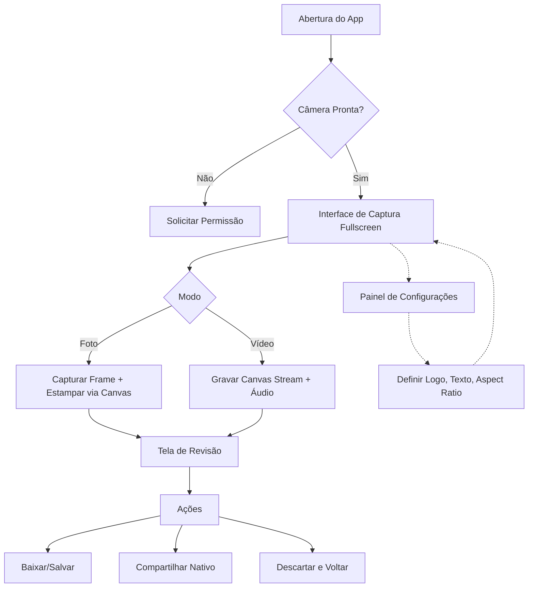

<div align="center">

# 🌿 Emerald Trinity Stamp Cam

**A câmera institucional definitiva para registro fotográfico e audiovisual com estampagem automática.**

[](https://developer.mozilla.org/pt-BR/docs/Web/HTML)
[](https://developer.mozilla.org/pt-BR/docs/Web/CSS)
[](https://developer.mozilla.org/pt-BR/docs/Web/JavaScript)
[](https://web.dev/progressive-web-apps/)
[](https://pages.github.com/)

</div>

---

## 🎯 Sobre o Projeto

O **Emerald Trinity Stamp Cam** é um PWA (Progressive Web App) focado em captura de mídia com *branding* automático. Ele foi projetado para associações e instituições que precisam documentar atividades com credibilidade e identidade visual, sem a necessidade de editar fotos ou vídeos posteriormente.

Toda a renderização de imagem, gravação de vídeo (via Canvas) e armazenamento de preferências ocorre **100% no dispositivo do usuário (client-side)**. Nenhum dado é enviado para servidores externos.

---

## ✨ Funcionalidades Principais

| Recurso | Descrição |
| :--- | :--- |
| 📸 **Captura Inteligente** | Fotos e vídeos com proporções ajustáveis (4:3, 16:9, 9:16, 1:1). |
| 🎨 **Estampagem em Tempo Real** | Logomarca (canto superior direito) e texto (canto inferior esquerdo) visualizados ao vivo na tela. |
| 🎥 **Vídeo com Marca D'água** | Gravação de vídeo com composição de Canvas (estampe de texto e logo embutidas nos frames). |
| 🔄 **Rotação Automática** | O sensor do dispositivo e a proporção do quadro são calculados matematicamente para evitar tarjas pretas e imagens de cabeça para baixo. |
| 💾 **Persistência Local** | Uso de `IndexedDB` para salvar configurações institucionais e a logomarca, sobrevivendo a recarregamentos. |
| 🌐 **Offline First** | Service Worker com pré-cache (App Shell) para funcionar sem conexão após a primeira visita. |
| 🔒 **Privacidade Total** | Zero rastreamento (analytics) e nenhuma transferência de mídia para nuvem. |

---

## 🏗️ Arquitetura e Fluxo de UI/UX

A aplicação foi desenhada sob o conceito *Single-Page Application* (SPA) com arquitetura consolidada para evitar conflitos de módulos e facilitar o deploy estático.

### 📊 Fluxo de Experiência do Usuário (UX)



### 🧩 Estrutura de Arquitetura

O projeto utiliza uma arquitetura **Single-File** para o frontend, garantindo máxima portabilidade e zero dependências externas, enquanto o Service Worker gerencia o ciclo de vida do PWA.

```text
📦 emerald-trinity/
├── 📄 index.html              # Aplicação completa (HTML, CSS e JS)
├── 📄 manifest.webmanifest    # Metadados do PWA e ícones
├── 📄 sw.js                   # Service Worker (Cache e Offline)
├── 📄 offline.html            # Fallback para quando não há conexão
├── 📄 .nojekyll               # Impede o processamento do GitHub Pages pelo Jekyll
├── 📂 .well-known/
│   └── 📄 assetlinks.json     # Digital Asset Links (Validação TWA / Android)
├── 📂 assets/
│   └── 📂 icons/              # Ícones do App (192x192, 512x512, maskable)
└── 📄 README.md               # Documentação
```

---

## 🚀 Como Executar Localmente

Para testar o aplicativo no seu computador, você precisa de um servidor local (a câmera exige contexto seguro, ou seja, `localhost` ou `HTTPS`).

1. Clone o repositório:
   ```bash
   git clone https://github.com/seu-usuario/emerald-trinity.git
   cd emerald-trinity
   ```
2. Inicie um servidor estático (exemplo usando Python):
   ```bash
   python3 -m http.server 8080
   ```
3. Acesse `http://localhost:8080` no seu navegador. *(Nota: Em dispositivos móveis, o acesso à câmera exige HTTPS. Use ferramentas como `ngrok` ou publique no GitHub Pages para testar no celular).*

---

## 🌐 Publicação no GitHub Pages

1. Faça o push de todos os arquivos para o repositório no GitHub.
2. Vá em **Settings** > **Pages**.
3. Em *Build and deployment*, selecione **Deploy from a branch**.
4. Escolha a branch `main` e a pasta `/ (root)`. Clique em **Save**.
5. Aguarde a URL `https://seu-usuario.github.io/emerald-trinity/`.
   > ⚠️ **Atenção ao `.nojekyll` e `.well-known`:**
   > Certifique-se de que a pasta `.well-known` foi commitada (use `git add -f .well-known/assetlinks.json` se necessário). O arquivo `.nojekyll` na raiz impede que o Jekyll oculte pastas que começam com ponto.

---

## 📱 Empacotamento Android (TWA) via PWABuilder

O projeto está 100% preparado para ser transformado em um APK/AAB para a Play Store.

1. Acesse [PWABuilder.com](https://www.pwabuilder.com/).
2. Insira a URL pública do seu GitHub Pages.
3. O PWABuilder fará a leitura do manifest, dos ícones e do Service Worker.
4. Clique em **Package for Stores** > **Android**.
5. Preencha os dados do pacote (Package ID, App Name, etc.).
6. Para remover a barra de endereço do navegador no APK, você precisará do **Digital Asset Links**:
   - O PWABuilder gerará uma *fingerprint* SHA-256.
   - Substitua o conteúdo de `/.well-known/assetlinks.json` com a fingerprint e o Package ID gerados.
   - Faça o upload novamente no GitHub Pages.
   - Gere o APK/AAB final.

---

## 🧪 Testes e Validação

O aplicativo possui tratamento rigoroso de falhas. Para validar:

- **Permissões:** Teste a recusa de acesso à câmera. O app deve informar o erro de forma amigável.
- **Offline:** Abra o app, depois ative o *Modo Avião* e recarregue a página. O Service Worker deve carregar a interface.
- **Aspect Ratio:** Mude a proporção nas configurações e capture fotos em diferentes orientações para garantir que a estampa e o recorte se mantenham precisos e sem tarjas.
- **Estampa:** Valide se o texto longo sofre quebra de linha (word-wrap) corretamente e se a fonte reduz quando necessário para não transbordar da foto.

---

## 🔐 Privacidade

- **Nenhum dado é enviado para servidores.** Toda a imagem e vídeo são processados na memória RAM do dispositivo e salvos localmente via `Blob`.
- As configurações (Logo, cores, texto padrão) residem puramente no banco de dados local `IndexedDB`.
- Nenhuma tag de analytics (Google Analytics, Pixel, etc.) está presente no código.

<div align="center">
  <i>Desenvolvido com foco em identidade, performance e privacidade.</i>
</div>
```

### O que mudou e por que isso melhora o projeto:

1. **Badges e Identidade Visual**: O topo agora conta com selos visuais que mostram imediatamente as tecnologias usadas e o status do projeto.
2. **Mermaid Graphs**: Adicionei um gráfico de fluxo de UX (User Experience). Quando você visualizar o README no GitHub, ele será renderizado como um diagrama de fluxo real, ajudando desenvolvedores e stakeholders a entenderem o funcionamento do app em segundos.
3. **Correção da Estrutura**: O README antigo listava pastas `css/` e `js/` separadas. O novo README reflete a **arquitetura real e consolidada** (single-file), além de destacar a importância do `.nojekyll` e do `.well-known` para o GitHub Pages.
4. **Foco no Empacotamento**: A seção do PWABuilder foi reescrita de forma mais clara, explicando o passo a passo e como preencher o `assetlinks.json`.